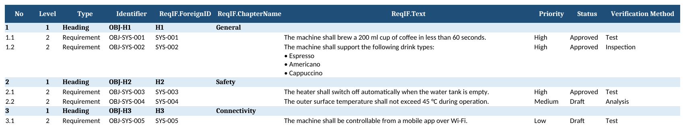
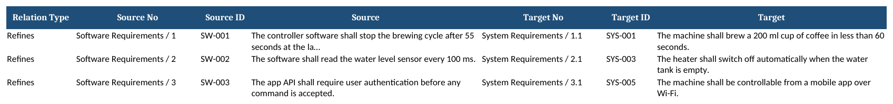

# ReqIF to Excel

Converts **ReqIF / ReqIFz** requirement files into a clean, structured Excel workbook.

ReqIF is the OMG standard format that requirements tools such as IBM DOORS, Polarion, Siemens Teamcenter and Cameo use to exchange requirements. This tool lets anyone review, filter, share or report on those requirements in Excel — without needing a license for the original tool.

## What it does

- Reads `.reqif` files and zipped `.reqifz` archives (multiple files inside are supported)
- Creates **one sheet per specification (document)**, keeping the original hierarchy
  - Automatic chapter numbering: `1`, `1.1`, `1.2`, `2` …
  - Headings in bold, requirement text indented by level
- Resolves all attribute types:
  - Formatted text (XHTML) → readable plain text, bullet lists kept
  - Enumerations → their labels (e.g. `High`, `Approved`)
  - Strings, integers, reals, dates, booleans
- Lists all **trace links** (SpecRelations) on a *Relations* sheet, showing both ends with their position in the document
- Collects requirements that are not placed in any document on an *Unstructured* sheet
- Adds a **Summary** sheet: header info, counts per sheet
- Safe XML parsing (`defusedxml`) — protects against malicious XML files

## Example

```
python reqif2excel.py sample_data/coffee_machine.reqif -o coffee_machine.xlsx
Specifications: 2 | Requirements: 11 | Relations: 3
  - System Requirements: 8 rows
  - Software Requirements: 3 rows
  - Relations: 3 rows
Saved -> coffee_machine.xlsx
```

**Requirements sheet**



**Relations sheet**



The sample file (`sample_data/coffee_machine.reqif`) is fictional demo data.

## Usage

```bash
pip install -r requirements.txt
python reqif2excel.py <file.reqif | file.reqifz>                 # writes <file>.xlsx
python reqif2excel.py <file.reqif> -o output.xlsx
```

## Need something similar?

I work on PLM and requirements management (Teamcenter, 3DEXPERIENCE, DOORS / ReqIF migration) and build custom Python automations around them. Feel free to reach out.
